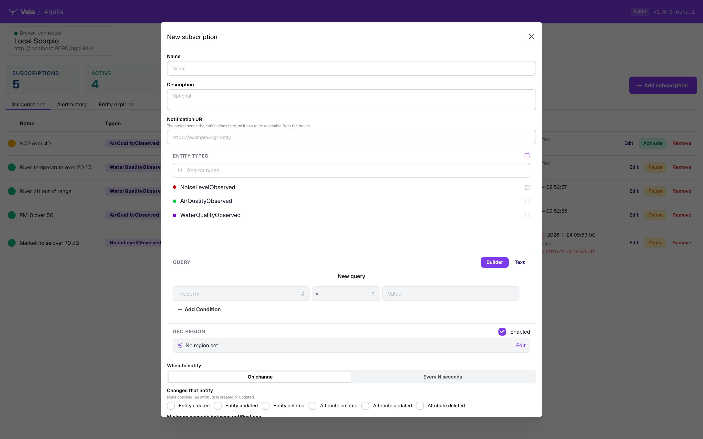

# Getting started

This page takes you from nothing to a subscription that delivers a notification. It runs a local Scorpio broker and a small notification receiver with Docker Compose, then runs Aquila from its container image against them. Every address on this page is on your own machine.

## What you need

- Docker with Compose.
- `git` and `curl`.
- A current version of Chrome, Edge, Firefox or Safari.

## 1. Start a broker and a receiver

The Aquila repository has a Compose file that starts Scorpio, its database, and a receiver that records every notification sent to it:

```bash
git clone https://github.com/vela-tools/aquila.git
cd aquila/docker
docker compose up -d
```

Scorpio takes a minute to start. It is ready when this request prints `200`:

```bash
curl -s -o /dev/null -w '%{http_code}\n' http://localhost:9090/ngsi-ld/v1/types
```

The receiver's page is at http://localhost:8099. It lists the notifications it has received and refreshes every five seconds.

The broker is published on port 9090 and the receiver on 8099. If either port is already in use on your machine, pick another one with `SCORPIO_PORT` (broker) or `RECEIVER_PORT` (receiver), for example `SCORPIO_PORT=9091 docker compose up -d`. Then use that port wherever this page says 9090 or 8099.

## 2. Create an entity

Give the broker something to watch, a water quality reading with a `pH` of 7.2:

```bash
curl -i -X POST http://localhost:9090/ngsi-ld/v1/entities \
  -H 'Content-Type: application/json' \
  -d '{"id":"urn:ngsi-ld:WaterQualityObserved:demo","type":"WaterQualityObserved","pH":{"type":"Property","value":7.2}}'
```

The broker answers `201 Created`.

## 3. Run Aquila

Run the image, pointed at the broker:

```bash
docker run --rm -p 2361:2361 \
  -e AQUILA_BROKER_URL=http://localhost:9090/ngsi-ld/v1 \
  -e AQUILA_BROKER_NAME="Local Scorpio" \
  ghcr.io/vela-tools/aquila:latest
```

Open http://localhost:2361. The header shows "Local Scorpio" as the selected broker, with its connection status. The broker URL is the address your browser uses to reach the broker, since Aquila runs in the browser. The Compose file already allows the origin `http://localhost:2361` in Scorpio's CORS settings.

The **Entity explorer** tab now lists the type `WaterQualityObserved`, the entity, and its `pH` attribute.

## 4. Create a subscription

On the **Subscriptions** tab, press **Add subscription** and fill in:

| Field            | Value                            |
| ---------------- | -------------------------------- |
| Name             | `pH too high`                    |
| Notification URI | `http://receiver:8099/notify/ph` |
| Entity types     | `WaterQualityObserved`           |
| Conditions       | `pH`, `>`, `8.5`                 |



Leave everything else as it is and press **Create subscription**. The subscription appears in the list as active.

The notification URI uses the name `receiver`, not `localhost`. The broker sends the notification from inside the Compose network, where `localhost` is the broker itself and the receiver is reachable by its service name. The last part of the path, `ph`, is a tag the receiver shows next to each notification.

You can also start from the data: pick the `pH` attribute in the entity explorer, and the editor opens with the type and the attribute already filled in.

## 5. Trigger it

Raise the `pH` above the threshold:

```bash
curl -i -X PATCH http://localhost:9090/ngsi-ld/v1/entities/urn:ngsi-ld:WaterQualityObserved:demo/attrs \
  -H 'Content-Type: application/json' \
  -d '{"pH":{"type":"Property","value":9.1}}'
```

The broker answers `204 No Content`, and within a few seconds the receiver's page shows a notification tagged `ph`, carrying the entity with its new `pH`. In Aquila, the subscription's **Delivery** column shows when the broker last notified, and one notification sent.

Set the `pH` back to 7.0 with the same request. Nothing new arrives: the condition is checked against the entity after the change, and a change that makes an entity stop matching sends nothing.

## 6. See a failing delivery

Edit the subscription and change its notification URI to `http://receiver:8099/notify/ph?status=500`. The receiver now answers every notification with an error. Raise the `pH` again, and the **Delivery** column marks the subscription as **Failing**, with the time of the last failure.

## Clean up

Stop Aquila with `Ctrl+C`. Stop the broker and the receiver, and delete their data, from the `docker` directory:

```bash
docker compose down -v
```

## Next

- Point Aquila at your own broker: [Deployment](deployment.md) covers the image, its configuration, and the CORS and network settings the broker needs.
- [The subscription editor](guides/subscription-editor.md) explains every field, and how the conditions, the watched attributes and the triggers decide when a notification is sent.
- [Known limitations](known-limitations.md) lists what this beta does not do yet.
