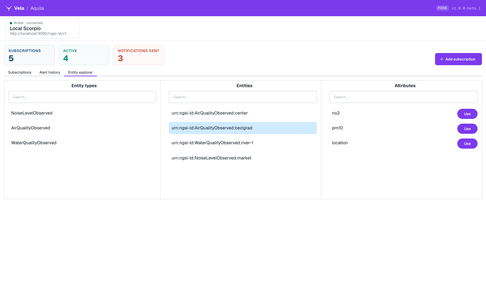

# Entity explorer

The **Entity explorer** tab shows what is on the selected broker: its entity types, the entities of each type, and their attributes. Use it to find the type and attribute names a subscription needs, in the short form the broker's @context gives them.

Picking an attribute opens the [subscription editor](subscription-editor.md) with that type and attribute already filled in. This is the quickest way to start a subscription on data you can see.

The explorer only reads. It does not change entities.
