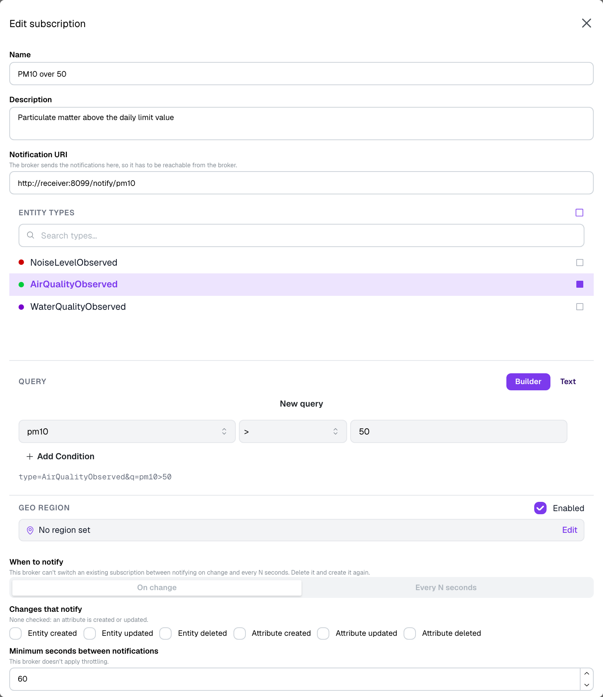
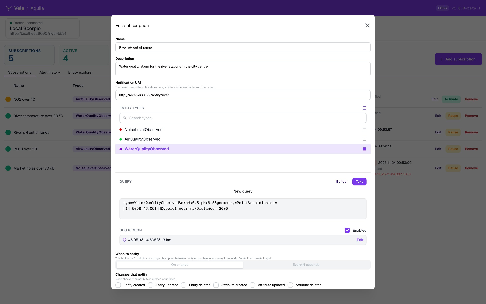

# Subscription editor

The editor builds an NGSI-LD subscription from a form. It opens from **Add subscription** on the Subscriptions tab, from an attribute in the [entity explorer](entity-explorer.md), or from **Edit** on a row of the list.

## What to watch

**Name and description.** The name is required and identifies the subscription in the list. The description is free text.

**Notification URI.** Where the broker sends each notification. The broker calls it, so it has to be reachable from the broker, not from your browser.

**Entity types.** One or more types. The subscription covers every entity of these types.

**Conditions.** Which entities match. Build them from an attribute, an operator and a value, and the editor shows the resulting NGSI-LD query as you go. Conditions built this way are combined with AND. For anything the builder cannot express, such as OR with `|`, parentheses, ranges or patterns, switch to text mode and write the query yourself.

**Geo region.** Optionally, a circle given by its centre and radius. Only entities inside it match.

## When to notify

A subscription notifies either on change or at a fixed interval.

**On change** sends a notification when a matching entity changes. You choose which kinds of change count: an entity created, updated or deleted, and an attribute created, updated or deleted. A minimum number of seconds between notifications can be set too, although not every broker applies it, as [broker compatibility](../reference/broker-compatibility.md) notes.

**Every N seconds** sends the matching entities at that interval, whether they changed or not.

**Watched attributes** narrow which changes count. Only a change to one of them triggers a notification. Left empty, the editor watches the attributes used in the conditions.

### How they combine

A notification is sent only when the change is of a kind the triggers include, touches a watched attribute, and leaves the entity matching the conditions. In detail, as checked against Scorpio:

- The conditions are checked against the entity after the change. For a deleted entity, they are checked against its last state, so deleting an entity that matched sends a notification with that state.
- A change that makes an entity stop matching sends nothing. A `pH` falling back below the threshold does not notify.
- With watched attributes set, creating an entity counts only if it has one of them. Without watched attributes, a change to any attribute counts.

## The rest of the subscription

| Field | What it sets |
| --- | --- |
| Expires | When the subscription stops notifying. Optional |
| Scope query | Only entities in these scopes match. Optional |
| Language | Which language to use for language properties in notifications. Optional |
| Notification format | Normalized, concise, or key-values. New subscriptions start with key-values |
| Payload | Only these attributes; attributes to leave out; previous values, which key-values cannot carry; system attributes |
| Advanced | The JSON-LD context of notifications, expanded values, JSON keys, and linked entities |

## Saving

Pressing **Save** checks the form first. A problem, such as a missing name, an expiry in the past, or previous values with key-values, is shown under the field, and nothing is sent to the broker.

When editing, Aquila sends only the members you changed. Some changes are refused before they are sent, because Scorpio would apply them incorrectly: removing a value a subscription already has, switching between on change and every N seconds, changing the language or the JSON-LD context. The editor says why next to the field. [Broker compatibility](../reference/broker-compatibility.md) has the full list.

If the broker rejects a change, Aquila reads the subscription again and says "The broker rejected the change, but may have applied part of it. The list shows what it has now." The editor continues from what the broker has.
