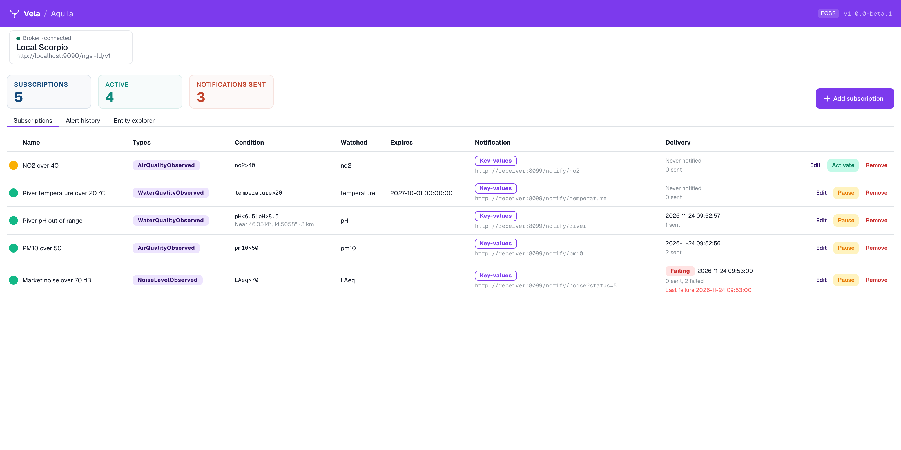

# Subscriptions

The **Subscriptions** tab lists every subscription on the selected broker, whether Aquila created it or not. Above the tabs, three counts summarise the broker: the number of subscriptions, how many of them are active, and how many notifications the broker has sent in total, the sum of each subscription's `timesSent`.

## The list

Each row is one subscription, as the broker reports it:

| Column | Shows |
| --- | --- |
| Status | Active, paused or expired |
| Name | The name, the description and the subscription's id |
| Types | The entity types it watches. "+ id selectors" means it also selects entities by id or id pattern |
| Condition | The query and the geographic circle, if any |
| Watched | The watched attributes |
| Expires | When the subscription expires |
| Notification | The notification URI, the format, and the payload options |
| Delivery | When the broker last notified, how many notifications were sent and how many failed, and the last failure |

## Delivery state

The **Delivery** column is how you tell whether a subscription works. The broker counts every notification it sends to the notification URI, and every one that fails. When the last notification failed, the row is marked **Failing**.

A failing subscription usually means the notification URI cannot be reached from the broker, or the service behind it answers with an error. Fix the URI or the service, and the mark clears once a notification is delivered again.

Aquila shows what the broker reports. It does not receive the notifications itself, so it cannot show what a notification contained. To see that, point the subscription at a receiver you control, such as the one in [Getting started](../getting-started.md).

## Editing, pausing and deleting

Each row has three actions:

- **Edit** opens the [subscription editor](subscription-editor.md) with the subscription.
- **Pause** stops the broker from sending notifications for the subscription, and **Activate** turns them back on. A paused subscription keeps its settings and its delivery counts. An expired subscription can't be paused or activated; to bring it back, edit it and set its expiry to a date in the future.
- **Delete** removes the subscription from the broker after you confirm.

## Subscriptions Aquila cannot read completely

A subscription can hold a value Aquila cannot read, for example a `throttling` that is not a number, which Scorpio can leave behind after a change it rejected. Such a subscription stays in the list, marked "Can't read" with the members Aquila left out, and those fields are locked in the editor. The rest of the subscription can still be edited.

Subscriptions created by other tools can also hold settings the editor does not show, such as `temporalQ` or `datasetId`. Aquila keeps them on the broker when you edit the subscription. [NGSI-LD subscription support](../reference/ngsi-ld-support.md) lists which members are shown, which are kept, and which are read-only.

## Alert history

The **Alert history** tab shows alerts recorded by the notification service used with earlier versions of Aquila. Notifications from subscriptions created in this version don't appear there yet. Alert history for every subscription is planned for the short term, on the [roadmap](../roadmap.md).
