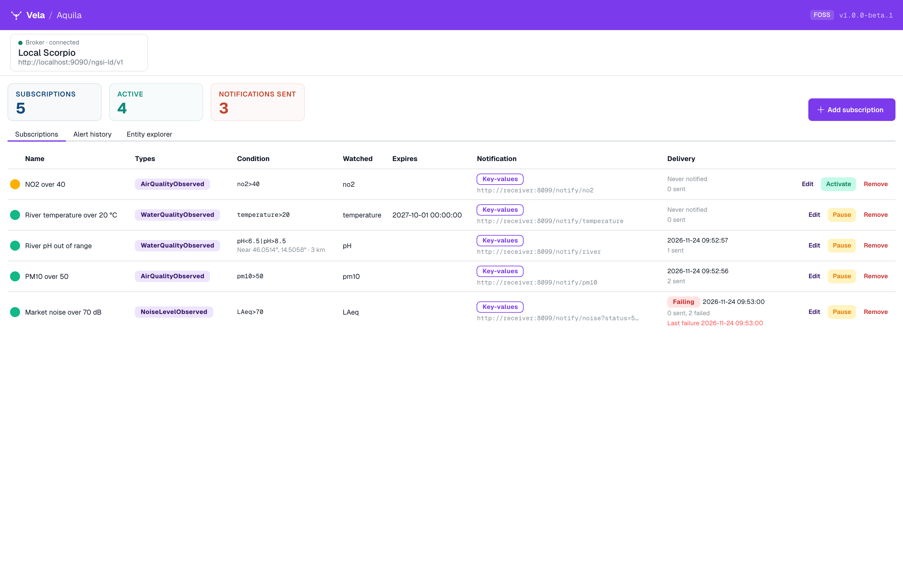

import DeploymentShape from '@site/src/components/DeploymentShape';

# Aquila documentation

Aquila is a web application for the subscriptions of an NGSI-LD context broker. You describe what to watch, for example a `pH` above 8.5 on any `WaterQualityObserved` entity inside a given area, and Aquila creates the matching subscription on the broker. After that, Aquila is no longer involved: whenever an entity matches, the broker sends a notification straight to the address you chose. Aquila shows which subscriptions exist, whether their notifications are being delivered, and lets you edit, pause, resume and delete them.

:::warning[Beta]

Aquila is in beta and has not been independently audited. It has been tested against the Scorpio broker only, and it has no logins of its own. Read the [known limitations](known-limitations.md) before you rely on it.

:::

## How Aquila works

<DeploymentShape />

Aquila runs entirely in the browser. The container image just serves the application files, plus a small `/config.json` that tells Aquila which broker to open by default. It has no backend, no database, and stores no context data.

The browser talks to the brokers you add directly, over the NGSI-LD API. It reads entity types, entities and subscriptions, and it creates, changes and deletes subscriptions. The list of brokers is kept in the browser, so each person using Aquila has their own.

The subscriptions themselves live on the broker. Whenever an entity changes, the broker checks it against every subscription and, for each one that matches, sends a notification to that subscription's notification URI. Aquila is not in that path: it never receives notifications, and a subscription keeps working whether Aquila is open or not. Because the broker makes the call, the notification URI has to be reachable from the broker, not from your browser.

## Where to start

- [Getting started](getting-started.md) runs Aquila with a local broker and a notification receiver, and takes you from an empty broker to a delivered notification.
- [Deployment](deployment.md) covers the container image, its configuration, and what the broker and the network need.
- The guides explain each part of the application: [brokers](guides/brokers.md), [the subscription list](guides/subscriptions.md), [the subscription editor](guides/subscription-editor.md) and [the entity explorer](guides/entity-explorer.md).
- The reference lists the [NGSI-LD subscription members](reference/ngsi-ld-support.md) Aquila reads and writes, and [what Scorpio does differently](reference/broker-compatibility.md) from the specification.
- [Known limitations](known-limitations.md) and the [roadmap](roadmap.md) say what this release does not do yet, and what comes next.
